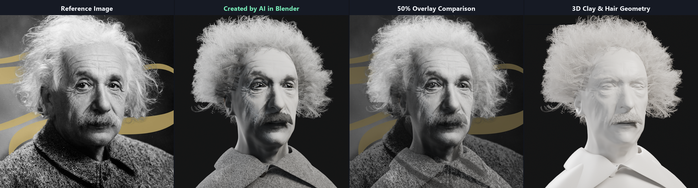

# Blender 3D Skills (`imagine_to_3d` & `reference_to_3d`)

Playbooks and Python libraries for creating 3D models, portraits, scenes, and 3D videos in Blender with an AI assistant.

---

## How to Use

### Step 1: Tell the AI to Read the Skill Files
Start your session by asking your AI assistant to read all the skill and playbook files in this repository (`imagine_to_3d/` and `reference_to_3d/`).

> Example: *"Read all the skill and playbook files in `imagine_to_3d/` and `reference_to_3d/` first, and follow their rules strictly."*

### Step 2: Provide Your Input

- **Reference Image to 3D (`reference_to_3d/`):**
  Upload your reference image and ask the AI to recreate it in Blender 3D.
- **Reference Video to 3D Video:**
  Provide the local file path to your reference video and ask the AI to recreate it as a 3D video.
- **Imagine to 3D / 3D Video (`imagine_to_3d/`):**
  Write your prompt directly describing the character, object, scene, or video you want—no reference image or video is needed.

---

## Requirements

- **Blender 5.2 LTS** (Cycles GPU rendering recommended).
- **MPFB2 (Open-Source Blender Extension — AGPLv3):** For realistic human portraits and full-body characters, install the free open-source **MPFB** extension inside Blender via `Edit > Preferences > Get Extensions > MPFB`.

---

## Included Folders

- **`imagine_to_3d/`** — Playbook and Python core modules for building 3D assets and videos directly from a prompt.
- **`reference_to_3d/`** — Playbooks and reconstruction, color/skin calibration, and comparison modules for recreating 3D models from reference media.
- **`examples/`** — Visual result showcase.
